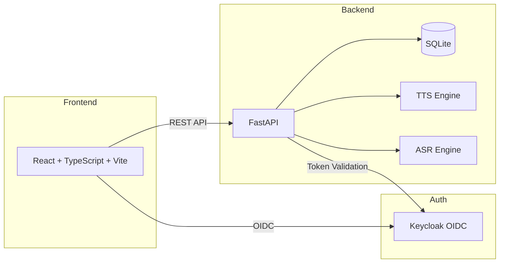

# VoiceStudio — Alan Vo | AI & Machine Learning

> Work in progress. This checkpoint may be incomplete or fail tests. See PLAN.md and STATUS.md before use.


VoiceStudio is an open-source, fully-local voice AI platform for voice cloning, voice design, video dubbing, dictation, transcription, and audiobook creation. Built as a local-first alternative to cloud-based voice services.

## Features

- **Voice Cloning**: Clone voices from reference audio samples
- **Voice Design**: Create custom voices with adjustable parameters
- **Video Dubbing**: Translate and dub videos into 646+ languages
- **Dictation**: Real-time speech-to-text transcription
- **Audiobook Creation**: Generate audiobooks with chapter support
- **Local-First**: All processing runs locally; no cloud dependencies required

## Architecture



## Quick Start

### Prerequisites

- Docker and Docker Compose
- Git

### Installation

```bash
# Clone the repository
git clone https://github.com/ALANDVO/orbit-station-144-alan-vo.git
cd orbit-station-144-alan-vo

# Copy environment template
cp .env.example .env

# Start all services
docker compose up -d

# Access the application
# Frontend: http://localhost:5173
# Backend API: http://localhost:8000
# API Docs: http://localhost:8000/docs
# Keycloak Admin: http://localhost:8080 (admin/admin)
```

### Local Development

```bash
# Backend
cd backend
python3 -m venv .venv
source .venv/bin/activate
pip install -r requirements.txt
uvicorn app.main:app --reload --host 0.0.0.0 --port 8000

# Frontend (separate terminal)
cd frontend
npm install
npm run dev
```

## API Reference

### Health Checks

- `GET /api/v1/health/` - Basic health check
- `GET /api/v1/health/db` - Database connectivity check

## Configuration

See `.env.example` for all configuration options.

### Key Environment Variables

| Variable | Description | Default |
|----------|-------------|---------|
| `DATABASE_URL` | SQLite database URL | `sqlite+aiosqlite:///./voicestudio.db` |
| `SECRET_KEY` | JWT signing secret (min 32 chars) | *required* |
| `KEYCLOAK_URL` | Keycloak server URL | `http://localhost:8080` |
| `KEYCLOAK_REALM` | Keycloak realm name | `voicestudio` |
| `KEYCLOAK_CLIENT_ID` | Keycloak client ID | `voicestudio-client` |
| `KEYCLOAK_CLIENT_SECRET` | Keycloak client secret | *required for production* |
| `LLM_API_KEY` | LLM provider API key | *optional* |
| `LLM_PROVIDER` | LLM provider type | `openai-compatible` |
| `LLM_MODEL` | LLM model name | `gpt-4o-mini` |
| `CORS_ORIGINS` | Allowed CORS origins | `["http://localhost:5173", "http://localhost:3000"]` |

## Authentication

VoiceStudio uses Keycloak for OIDC authentication with:
- Authorization Code flow with PKCE
- Roles: `viewer`, `operator`, `admin`
- CORS restricted to configured origins
- LLM API keys stored server-side only; never exposed to frontend

## Backup & Restore

```bash
# Backup database
cp voicestudio.db voicestudio.db.backup

# Backup Keycloak data
docker compose exec keycloak /opt/keycloak/bin/kc.sh export --dir /opt/keycloak/data/export
```

## License

MIT License - Copyright (c) 2024 Alan Vo <alanvo@gmail.com>

## Author

**Alan Vo** | AI & Machine Learning

- Email: alanvo@gmail.com
- GitHub: @ALANDVO